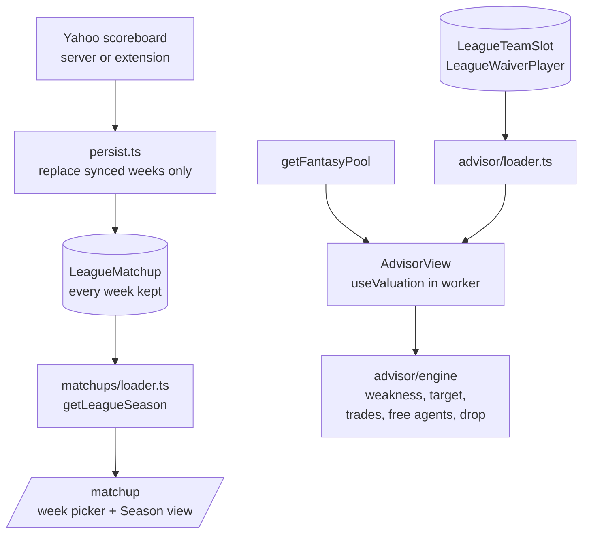
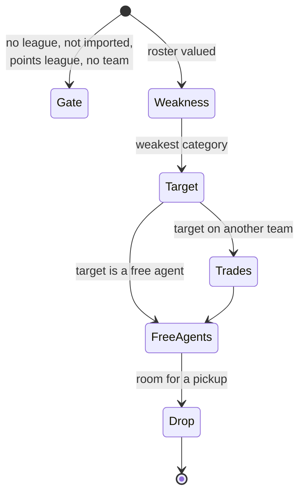
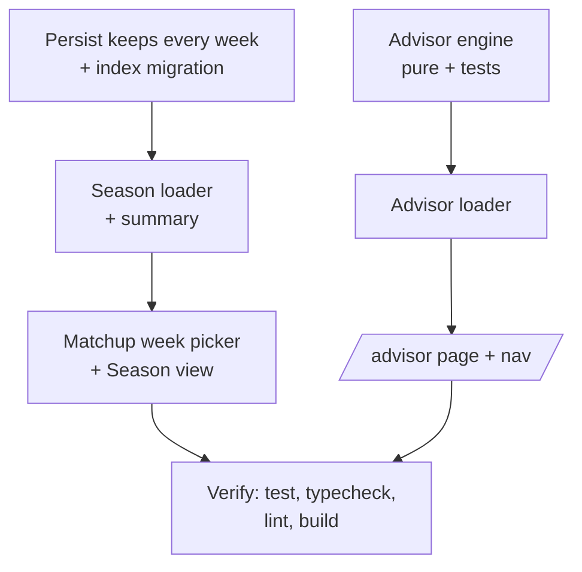

# Season matchups and the Roster Advisor

Date: 2026-10-29. Status: built. Two features for an imported head-to-head categories league: every week's matchup is kept so the season can be read back, and a Roster Advisor names the team's biggest weakness, finds the player who fixes it, and lays out trades, free agents and a drop.

## Why

Today `LeagueMatchup` holds only the current week: each sync deletes every row for the league and writes the new scoreboard, so last week's result is gone the moment Yahoo rolls the week over. A manager can see where they stand this week but never how the season has gone, which categories they keep losing, or how a past week ended.

The Waiver Wire already answers "who on the wire beats my weakest player", but it thinks in overall value. Head-to-head categories is won category by category, so the sharper question is "which category am I losing, and who fixes it", including players on other teams, which means trades.

## Goals

- Never lose a stored week. A sync replaces only the weeks its scoreboard carries.
- The Matchup page can show any stored week (`?week=N`), for both the head-to-head and the league totals view.
- A new Season view: the season record, one row per week (opponent, score, result), and a per-category table (weekly average, category record, average league rank).
- A Roster Advisor page (`/advisor`) that:
  - ranks every scored category by where my roster stands against the league and names the weakest;
  - finds the best player for that category, on another team or in the free pool;
  - when that player is rostered elsewhere, offers exactly three trades: one that favors me, one that is fair, one that favors the other manager;
  - lists two to five free agents who help that category;
  - names which of my players to drop to make room for a free agent.

## Non-goals

- Backfilling weeks that were synced before this change. History starts with the first sync after it ships (week 1 or 2 of the 2026 season, so little is lost).
- Sending a trade proposal or a waiver claim to Yahoo. The advisor recommends; the manager acts in Yahoo.
- Points leagues. Both features are head-to-head categories only, as the Matchup page already is.

> [!CAUTION]
> Anti-goal: a recommendation that cannot be explained. Every suggestion shows the numbers it came from (category score, value, value balance), so a manager can disagree with it on the facts.

## Design

### Architecture

### Schema

No new table. `LeagueMatchup` already carries `week`; the change is in how it is written and read. A migration adds `@@index([leagueId, week])` for the per-week reads and the per-week delete.

> [!TIP]
> A sync deletes `LeagueMatchup` rows for the weeks in its scoreboard and writes them again, inside the same transaction as before. A successful but empty scoreboard no longer clears anything, because "no matchups this week" says nothing about last week.

### Season matchups

- `toLeagueSeason` groups stored rows by week and builds one `LeagueWeek` per week with the existing `toLeagueWeek`. `getLeagueSeason` returns them oldest first.
- The page picks the week from `?week=N`, falling back to the latest stored week. A week picker (keycap links, `aria-current` on the shown week) sits above the head-to-head and league views.
- `buildSeasonSummary` (pure, `lib/matchups/season.ts`) scores each week with the existing `scoreMatchup`, and per category counts my wins, losses and ties, averages my weekly total, and averages my league rank from `rankCategory`.
- A week's result reads from Yahoo's status: `postevent` is final (Won, Lost, Tied), `midevent` is "In progress", `preevent` is "Upcoming", and a week without an opponent is a "Bye". The season record counts final weeks only.

> [!IMPORTANT]
> Ratio categories (FG%, FT%) are averaged across weeks as weekly percentages, not recomputed from makes and attempts, because Yahoo's scoreboard only gives the percentage. Good enough for a trend, labelled "Weekly avg".

### Roster Advisor

All of it runs on the client, on the same valued pool the Waiver Wire uses (`useValuation` in the worker, the league's own config), so a player's value matches every other screen. The engine is pure functions in `lib/advisor/`.

| Step              | Rule                                                                                                                                                                                                                                                                                                                                                                                                                                                                                                                                                  |
| ----------------- | ----------------------------------------------------------------------------------------------------------------------------------------------------------------------------------------------------------------------------------------------------------------------------------------------------------------------------------------------------------------------------------------------------------------------------------------------------------------------------------------------------------------------------------------------------- |
| Category standing | Sum the method's per-category score (z, or g for G-Score) over each team's healthy roster (IL and IL+ left out). Rank teams per category, 1 best.                                                                                                                                                                                                                                                                                                                                                                                                     |
| Weakness          | My worst rank; ties broken by the biggest gap below the league average.                                                                                                                                                                                                                                                                                                                                                                                                                                                                               |
| Target            | The highest score in that category among players on other teams and free agents whose overall value is at least my healthy roster's median, so the fix is a real player and not a one-category specialist. If nobody clears the bar, the best in the category.                                                                                                                                                                                                                                                                                        |
| Trades            | Only when the target is on another team. Packages are every single player and every pair from my healthy roster. Each offer aims at a value balance: favors me at about 1.5 margins under the target's value, fair at even, favors them at about 1.5 margins over, where a margin is a quarter of the target's value (at least 0.5). Packages that give away weak-category production cost extra. The three offers are distinct packages, chosen together at the lowest total cost, and a lopsided offer on the wrong side of even costs most of all. |
| Free agents       | Free-pool players ranked by the weak category's score, keeping those worth more overall than my drop candidate, up to five. When fewer than two qualify, the next best in the category fill to two and are marked as not an overall upgrade.                                                                                                                                                                                                                                                                                                          |
| Drop              | My healthy player with the lowest value once their weak-category contribution is added back, so the advisor never drops the player who is propping up the category it is trying to fix.                                                                                                                                                                                                                                                                                                                                                               |

> [!TIP]
> The advisor is deterministic, not an LLM call. Every input is already a number the app computes, the rules above are testable, and there is no API key, cost or latency to add. A written summary from Claude can sit on top later without changing the engine.

> [!WARNING]
> Values on z and g scales can be negative for bench players, so "favors me" is measured as a value difference, never as a ratio. A 2-for-1 also asks the other manager to drop someone; the offer says so.

### User flow

## Testing

- `persist.test.ts`: a sync keeps a previous week's rows and replaces the synced week.
- `loader.test.ts`: `toLeagueSeason` groups by week and orders oldest first.
- `season.test.ts`: results per status, season record, per-category record, average and rank.
- `lib/advisor/*.test.ts`: weakness ranking and tie-break, target bar and fallback, three distinct trade offers at the right balances, two to five free agents with the fill rule, drop protecting the weak category. Every type guard has its own test.
- Component tests for the Season panel, the week picker and the advisor view, plus the page gates.

## Order of work

## Risks

> [!WARNING]
> Rows written before this change are only the current week, so a season view in the first week after release shows one or two weeks. It fills in as the season goes.

> [!WARNING]
> The weakness comes from the roster as it stands, not from past matchups. A team that lost rebounds every week but just traded for a center reads as fixed, which is the point, but it can disagree with the Season view's category record.
